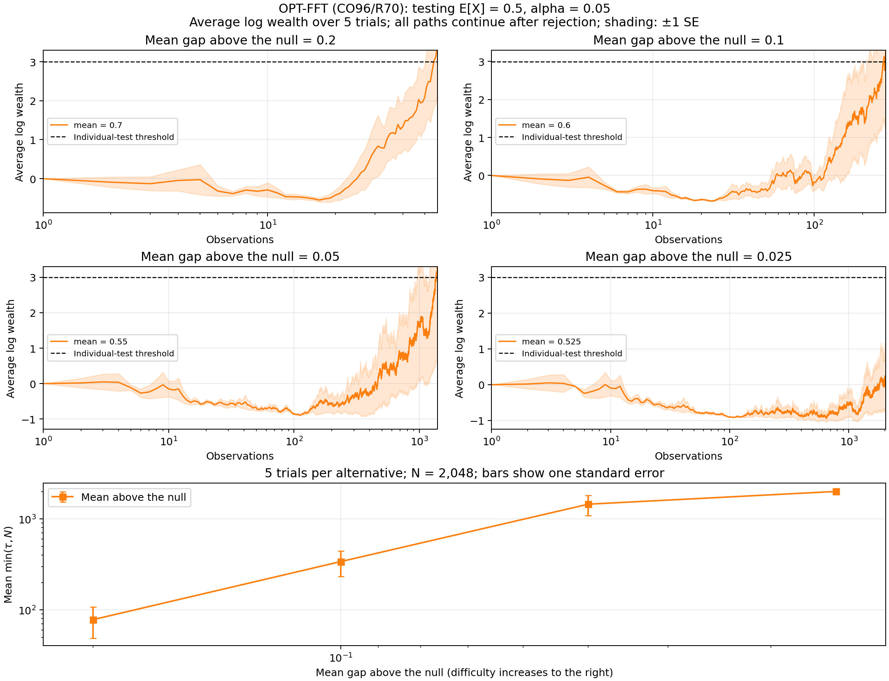

# OPT-FFT

**Optimal Portfolio Testing with Fast Fourier Transforms**

Test whether independent observations in `[0, 1]` have mean `mu0`, against the two-sided alternative that the mean differs from `mu0`. The test uses a 50/50 mixture of the CO96 and R70 priors and rejects when betting wealth first reaches `1 / alpha`, as described in Remark 2 of Orabona and Jun (IEEE Trans. Information Theory, 2024).
Here, we denote by

- **CO96**: the `Beta(1/2, 1/2)` prior on the two-stock portfolio allocation analyzed by Cover and Ordentlich (1996).
- **R70**: the prior proposed by Robbins (1970), adapted by Orabona and Jun (2024) to betting fractions in `[-1, 1]`.

OPT-FFT uses a Fast Fourier Transform to evaluate the portfolio algorithm exactly in O(T ln^2 T) time.

The algorithm and motivation are described in 

```
@article{orabon2026optimal,
  title={Optimal Priors for Betting Tests with Bounded Payoffs: An Exact Expected-Time Characterization},
  author={Orabona, Francesco},
  journal={arXiv preprint arXiv:2610.25821},
  year={2026}
}
```

## Installation

Run all commands from the `python/` directory:

```bash
python -m pip install -r requirements.txt
```

## Test a specified mean

```python
import numpy as np
from opt_fft import betting_mean_test

x = np.random.default_rng(2026).binomial(1, 0.6, size=10000)
result = betting_mean_test(x, mu0=0.5, alpha=0.05)
print(result.rejected, result.stopping_time)
```

Pass a finite one-dimensional array in `[0, 1]` and a null mean strictly between
zero and one. `alpha` is the type-I error level, also strictly between zero and
one. For data in `[a, b]`, use `(x - a) / (b - a)` and
`(mu0 - a) / (b - a)`.

The result contains:

- `rejected`: whether the test rejected at any observed time.
- `stopping_time`: the first rejection time, counted from one, or `None`.
- `p_values`: an array of anytime p-values.
- `wealth.log_wealth`: an array of log wealth at each observation.

Rejection remains recorded even if wealth later falls. Non-rejection does not
establish that the null is true.

## Command line

Supply a one-column CSV/text file without a header, or a `.npy` array:

```bash
python opt_fft.py data.npy --mu0 0.5 --alpha 0.05 --output mean_test.csv
```

The output columns are `n,x,log_wealth,p_value,rejected`. The rejection column
stays one after the first crossing.

## Moment accuracy

R70 preprocessing uses the substitution `abs(beta) = sin(phi)`, integrates
the mass near zero analytically, and applies Gaussian quadrature on panels
that resolve both the density and the required cosine frequencies. An
oversampled nonuniform FFT computes all the even Chebyshev moments together;
the zeroth and odd moments are exact.

The default absolute moment tolerance is `1e-13`. Set `moment_tol` in
`betting_mean_test` or `FFTPortfolio`, or use `--moment-tol` on the command
line. For repeated tests, reuse the same engine; the R70 moments do not
depend on the null mean:

```python
from opt_fft import FFTPortfolio

engine = FFTPortfolio(10000, moment_tol=1e-13)
result = engine.test(x, mu0=0.5, alpha=0.05)
```

The tolerance controls absolute moment approximation error before floating-point roundoff. Computed allocations are projected onto their admissible intervals, and wealth is accumulated from their returns. Fix the horizon before observing the data when interpreting these allocations as a predictable betting strategy.

Run the independent integration, Fourier accuracy, and betting checks with:

```bash
OPENBLAS_NUM_THREADS=1 python -m unittest -v test_opt_fft.py
```

## Run the experiments

```bash
OPENBLAS_NUM_THREADS=1 python demo.py
```

The OPT-FFT demo simulates only Bernoulli means `mu0 + gap`, above the null.
The default means are `0.7, 0.6, 0.55, 0.525`; smaller gaps are harder to detect.
Customize the experiment with these options:

| Option | Default | Meaning |
| --- | --- | --- |
| `--mu0` | `0.5` | Null mean |
| `--alpha` | `0.05` | Type-I error level |
| `--gaps` | `0.2 0.1 0.05 0.025` | Positive gaps above the null, each smaller than `1-mu0` |
| `--trials` | `100` | Independent trials per alternative |
| `--n` | `10000` | Observations per trial |
| `--seed` | `2026` | Random seed |
| `--output-dir` | `results/` | Output directory |

Add `--validate` to run a numerical check on the first 256 observations of the
first trial in each scenario.

Curves show average log wealth over all trials, including after rejection,
with shading of ±1 standard error. The display ends 10% above the individual
test's log rejection threshold, while saved traces cover the full horizon.

Stopping-time averages count trials that have not rejected by the horizon as
having reached the horizon. They therefore summarize capped stopping times.



[Summary](results/summary.csv) · [Individual trials](results/trials.csv) ·
[Detailed results](results/mean_tests.json) · [PDF figure](results/mean_tests.pdf)

Each scenario also saves `trace_gap_<gap>_above.csv`, with columns
`n,mean_log_wealth,se_log_wealth,trials`. With one trial, shading is omitted, and
the standard-error column is zero. All outputs are in [results/](results/).
